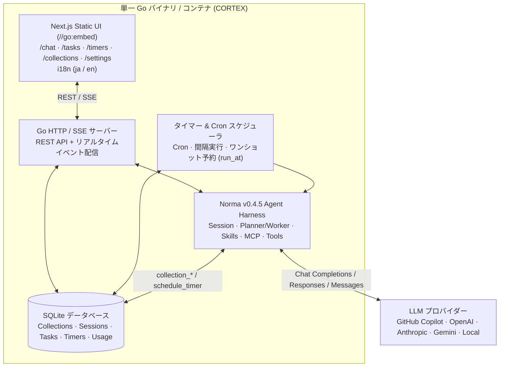

# CORTEX

[English](README.md) | [日本語](README.ja.md)

**CORTEX** は、Go と Next.js でスクラッチ構築されたクリーンルーム実装の汎用 AI エージェント・アプリケーションフレームワークです。
単一バイナリの Go バックエンド、`//go:embed` で埋め込まれた Next.js 静的フロントエンド、SQLite 永続化、**GitHub Copilot ネイティブ統合**を含むマルチ LLM ルーティング、自律タスク・グラフ実行、タイマー/スケジューラ、そしてスキーマレスな汎用 JSON コレクションストアを標準搭載しています。新しい LLM アプリケーションを開発する際、LLM やエージェント制御のボイラープレートを書くことなく、**ドメイン固有の画面とプロンプトの実装だけに集中**できます。

エージェント SDK として Apache-2.0 ライセンスの [**Norma**](https://github.com/h-morozumi/Norma) (`v0.4.5`) を採用し、フレームワーク全体は商用・派生開発でも使いやすい **MIT License** で公開されています。

---

## 主な特徴

- **単一バイナリ & Docker 両対応**: Next.js の Static Export (`web/out`) を `//go:embed` で Go バイナリに埋め込み、SQLite を標準内蔵。実行ファイル 1 つ（`cortex` / `cortex.exe`）でも、`docker compose up` でも即座に起動します。
- **Go 側を触らずにドメインアプリを構築可能**: 汎用 JSON コレクションストア API（`/api/collections/{name}`）とエージェント標準ツール（`collection_list`, `collection_get`, `collection_put`, `collection_delete`）により、Next.js 画面と AI エージェント間で任意のドメインデータをそのまま読み書きできます。
- **標準で多言語対応 (i18n)**: UI の日英切り替え（`ja.json` / `en.json`）を標準搭載し、選択した言語に合わせて AI エージェントの思考・出力言語も自動連動します。
- **LLM 設定 & GitHub Copilot ネイティブ統合**:
  - GitHub Copilot ネイティブ対応（OAuth デバイスフロー認証、セッショントークン自動交換、`/chat/completions`, `/responses`, `/v1/messages` エンドポイント対応、利用可能モデル一覧の動的取得）。
  - OpenAI, Anthropic, Google Gemini, OpenRouter, DeepSeek, Azure OpenAI, ローカル LLM (Ollama / vLLM) のプリセット対応。
  - プロバイダー間の自動フェイルオーバーとトークン・コスト集計。
- **標準チャット機能 (`/chat`)**: エージェント切り替え、マルチターン会話履歴、SSE リアルタイムストリーミング（Thinking・ツール呼び出し可視化）、ファイル添付に対応。
- **自律タスク & グラフ実行 (`/tasks`)**: 目標（Goal）の自動分解 → Planner ⇄ Worker サブエージェント並列実行 → 汎用成果物（Artifact）およびレポート生成。
- **タイマー・スケジューラ機能 (`/timers`)**: 定期実行（Cron / インターバル）、日時指定ワンショット予約（`run_at`）、および AI エージェント自身が未来の自分のタスクを予約できる `schedule_timer` ツールを搭載。
- **豊富な拡張機能**: エージェント/プロンプト管理、スキル管理（`skills/*/SKILL.md`）、MCP (Model Context Protocol) 接続、カスタムツール（Python / Bash / HTTP）、API キー不要の Web 検索（`ddgs`）。

---

## アーキテクチャ構成



---

## ディレクトリ構成

```text
CORTEX/
├── cmd/
│   └── cortex/             # メインエントリポイント (web/out を埋め込み)
├── internal/
│   ├── agent/              # Norma v0.4.5 ランタイムラッパー & 標準組み込みツール
│   ├── config/             # 環境変数・ランタイム設定
│   ├── i18n/               # 多言語 (ja/en) 管理 & エージェント出力言語連動
│   ├── server/             # HTTP/SSE API サーバー & 静的ファイル配信
│   └── store/              # SQLite 永続化 & 汎用 JSON コレクションストア
├── skills/                 # 宣言的エージェントスキル (SKILL.md)
├── web/                    # Next.js + TypeScript + Tailwind CSS + shadcn/ui フロントエンド
│   ├── src/
│   │   ├── app/            # 各機能画面 (/chat, /tasks, /timers, /collections, /settings)
│   │   ├── components/     # 共通 UI コンポーネント・ナビゲーション
│   │   └── i18n/           # 翻訳辞書 (en.json, ja.json) & I18n プロバイダー
│   └── next.config.ts      # Static Export (output: "export") 設定
├── Dockerfile              # マルチステージビルド (Node -> Go -> 軽量ランタイム)
├── docker-compose.yml      # Docker Compose 構成ファイル
├── go.mod                  # Go モジュール定義 (Norma v0.4.5)
├── LICENSE                 # MIT ライセンス
├── README.md               # 英語版 README
└── README.ja.md            # 日本語版 README (本ファイル)
```

---

## クイックスタート

### 1. Docker Compose で起動する

```bash
docker compose up --build
```

ブラウザで `http://localhost:8080` を開きます。

### 2. ローカルで単一バイナリをビルドして起動する

```bash
# 1. Next.js 静的フロントエンドのビルド
cd web
npm install
npm run build
cd ..

# 2. Go 単一バイナリのビルドと起動 (web/out をバイナリに内蔵)
go build -o cortex ./cmd/cortex
./cortex
```

### 3. 主な環境変数

| 変数名 | デフォルト値 | 説明 |
|---|---|---|
| `PORT` | `8080` | HTTP サーバーの待受ポート |
| `CORTEX_DB_PATH` | `./data/cortex.db` | SQLite データベースファイルの保存先 |
| `CORTEX_SKILLS_DIR` | `./skills` | `SKILL.md` を配置するスキルディレクトリ |
| `CORTEX_LOCALE` | `en` | 初期表示・エージェント応答言語 (`en` または `ja`) |
| `OPENAI_API_KEY` | *(任意)* | デフォルトの OpenAI 互換 API キー |
| `ANTHROPIC_API_KEY` | *(任意)* | デフォルトの Anthropic API キー |

---

## ドメインアプリケーションの作り方

1. GitHub 上で本リポジトリの **`Use this template`** から新しいリポジトリを作成します。
2. **汎用 JSON コレクション API (`/api/collections/{name}`)** を使ってドメインデータを保存・取得します（Go コードの変更は不要です）:
   - `GET /api/collections/projects` — ドキュメント一覧取得
   - `POST /api/collections/projects` — ドキュメント新規作成
   - `PUT /api/collections/projects/{id}` — ドキュメント更新
   - `DELETE /api/collections/projects/{id}` — ドキュメント削除
3. **AI エージェントからのデータ操作**: エージェントには標準で `collection_list`, `collection_get`, `collection_put`, `collection_delete` および未来のタスクを予約する `schedule_timer` ツールが組み込まれています。
4. **ドメインスキルの追加**: `skills/<スキル名>/SKILL.md` を配置するだけで、エージェントに専門知識や手順を付与できます。

---

## ロードマップ

- [ ] **多言語対応 (i18n) 基盤**: UI の日英切り替え（`en.json` / `ja.json`）および AI エージェントの出力言語連動
- [ ] **LLM 設定・GitHub Copilot ネイティブ統合**: OAuth デバイスフロー認証、セッショントークン自動交換、`/chat/completions`・`/responses`・`/v1/messages` 対応、フェイルオーバー、トークン/コスト集計
- [ ] **標準チャット機能 (`/chat`)**: エージェント切替、マルチターン会話履歴、SSE リアルタイムストリーミング（Thinking・ツール呼び出し表示）、ファイル添付
- [ ] **自律タスク & グラフ実行 (`/tasks`)**: Goal 分解 → Planner ⇄ Worker 並列実行 → 汎用成果物（Artifact）＆レポート生成
- [ ] **タイマー・スケジューラ機能 (`/timers`)**: 定期実行（Cron / 間隔）、日時指定ワンショット予約（`run_at`）、およびエージェント自身の予約ツール（`schedule_timer`）
- [ ] **拡張機能スイート**: エージェント/プロンプト管理、スキル（`skills/`）、MCP 接続、カスタムツール（Python/Bash/HTTP）、Web 検索（`ddgs`）

---

## ライセンス

[MIT License](LICENSE) の下で公開されています。
CORTEX は Apache-2.0 ライセンスの [Norma](https://github.com/h-morozumi/Norma) を用いて 100% クリーンルームでスクラッチ実装されています。
