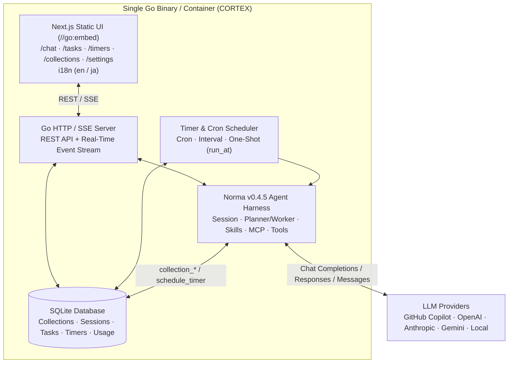

# CORTEX

[English](README.md) | [日本語](README.ja.md)

**CORTEX** is a general-purpose, clean-room AI Agent Application Framework written in Go and Next.js. It packages a single-binary Go server, an embedded Next.js static UI, SQLite persistence, multi-provider LLM routing (including native **GitHub Copilot** integration), autonomous multi-agent task execution, timers/schedulers, and a schema-free JSON Collection Store so you can build domain-specific AI applications by focusing only on your domain UI and prompts.

Built on top of the Apache-2.0 licensed [**Norma**](https://github.com/h-morozumi/Norma) (`v0.4.5`) Agent Harness SDK and released under the **MIT License**.

---

## Key Features

- **Single-Binary & Docker Ready**: Next.js Static Export (`web/out`) is embedded into the Go binary via `//go:embed`. Run a single executable (`cortex` / `cortex.exe`) with embedded SQLite or deploy via Docker Compose.
- **Zero-Backend-Code Domain Prototyping**: Use the Generic JSON Collection Store API (`/api/collections/{name}`) and built-in agent collection tools (`collection_list`, `collection_get`, `collection_put`, `collection_delete`) to read and write structured domain data between your Next.js UI and AI agents without modifying Go code.
- **First-Class Internationalization (i18n)**: Built-in English (`en.json`) and Japanese (`ja.json`) UI localization, synchronized with the AI agent's response language.
- **Multi-Provider LLM & Native GitHub Copilot Support**:
  - GitHub Copilot native integration (OAuth Device Flow, automatic session token exchange, `/chat/completions`, `/responses`, `/v1/messages`, and dynamic model discovery).
  - Presets for OpenAI, Anthropic, Google Gemini, OpenRouter, DeepSeek, Azure OpenAI, and local Ollama/vLLM endpoints.
  - Provider failover and token/cost accounting.
- **Standard Streaming Chat (`/chat`)**: Multi-turn conversations, agent profile switching, real-time Server-Sent Events (SSE) for text, thinking/reasoning blocks, and tool calls, plus file attachments.
- **Autonomous Task & Graph Execution (`/tasks`)**: Goal decomposition into a DAG, parallel Planner ⇄ Worker subagent execution, and structured artifact/report generation.
- **Timers & Self-Scheduling Agents (`/timers`)**: Recurring schedules (Cron / intervals), one-shot timestamped runs (`run_at`), and the `schedule_timer` tool allowing agents to schedule their own follow-up tasks.
- **Extensible Capabilities**: Agent/prompt management, declarative Skills (`skills/*/SKILL.md`), Model Context Protocol (MCP) client connections, Custom Tools (Python / Bash / HTTP), and keyless Web Search (`ddgs`).

---

## Architecture



---

## Directory Structure

```text
CORTEX/
├── cmd/
│   └── cortex/             # Main application entrypoint (embeds web/out)
├── internal/
│   ├── agent/              # Norma v0.4.5 runtime wrapper & built-in tools
│   ├── config/             # Environment and runtime configuration
│   ├── i18n/               # Locale management & agent language synchronization
│   ├── server/             # HTTP/SSE API server & static asset handler
│   └── store/              # SQLite persistence & Generic JSON Collection Store
├── skills/                 # Declarative agent skills (SKILL.md)
├── web/                    # Next.js + TypeScript + Tailwind CSS + shadcn/ui frontend
│   ├── src/
│   │   ├── app/            # App Router views (/chat, /tasks, /timers, /collections, /settings)
│   │   ├── components/     # Shared UI & layout components
│   │   └── i18n/           # Translation dictionaries (en.json, ja.json) & provider
│   └── next.config.ts      # Configured with output: "export"
├── Dockerfile              # Multi-stage build (Node -> Go -> minimal runtime)
├── docker-compose.yml      # Ready-to-run container orchestration
├── go.mod                  # Go module definition (Norma v0.4.5)
├── LICENSE                 # MIT License
├── README.md               # English documentation
└── README.ja.md            # Japanese documentation
```

---

## Quick Start

### 1. Run with Docker Compose

```bash
docker compose up --build
```

Open `http://localhost:8080` in your browser.

### 2. Build Single Binary Locally

```bash
# 1. Build the Next.js static frontend
cd web
npm install
npm run build
cd ..

# 2. Build and run the Go binary (embeds web/out)
go build -o cortex ./cmd/cortex
./cortex
```

### 3. Environment Variables

| Variable | Default | Description |
|---|---|---|
| `PORT` | `8080` | HTTP server port |
| `CORTEX_DB_PATH` | `./data/cortex.db` | SQLite database file path |
| `CORTEX_SKILLS_DIR` | `./skills` | Directory containing `SKILL.md` packages |
| `CORTEX_LOCALE` | `en` | Default locale (`en` or `ja`) |
| `OPENAI_API_KEY` | *(optional)* | Default OpenAI-compatible API key |
| `ANTHROPIC_API_KEY` | *(optional)* | Default Anthropic API key |

---

## Building Your Own Domain App on CORTEX

1. **Use this template repository** on GitHub (`Use this template` -> `Create a new repository`).
2. **Store domain records via `/api/collections/{name}`**:
   - `GET /api/collections/projects` — list items
   - `POST /api/collections/projects` — create an item
   - `PUT /api/collections/projects/{id}` — update an item
   - `DELETE /api/collections/projects/{id}` — delete an item
3. **Let agents read/write your collections**: Agents automatically have `collection_list`, `collection_get`, `collection_put`, and `collection_delete` tools, plus `schedule_timer` for future follow-ups.
4. **Add domain skills**: Drop a `SKILL.md` into `skills/<your-skill>/SKILL.md` to give agents specialized domain workflows.

---

## Roadmap

- [x] **i18n Foundation**: Full UI (`en.json` / `ja.json`) and AI agent output language synchronization
- [x] **LLM Provider Hub & GitHub Copilot Native Integration**: OAuth Device Flow, automatic token exchange, `/chat/completions`, `/responses`, `/v1/messages`, failover, and token/cost telemetry
- [x] **Standard Streaming Chat (`/chat`)**: Multi-turn chat persistence, agent switcher, SSE streaming (thinking & tool calls), and file attachments
- [ ] **Autonomous Task & Graph Execution (`/tasks`)**: Goal decomposition, parallel Planner ⇄ Worker execution, and artifact/report generation
- [ ] **Timers & Scheduler (`/timers`)**: Cron/interval schedules, one-shot `run_at` jobs, and the `schedule_timer` agent tool
- [x] **Extensibility Suite**: Agent/Prompt studio, Skills (`skills/`), MCP client manager, Custom Tools (Python/Bash/HTTP), and Web Search (`ddgs`)

---

## License

Released under the [MIT License](LICENSE).
CORTEX is a 100% clean-room implementation powered by [Norma](https://github.com/h-morozumi/Norma) (Apache-2.0 License).
